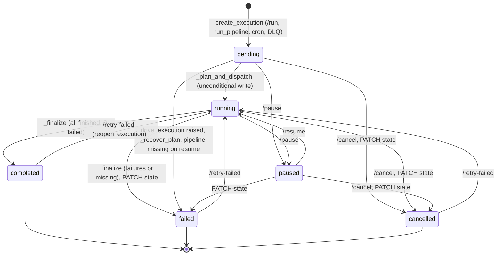
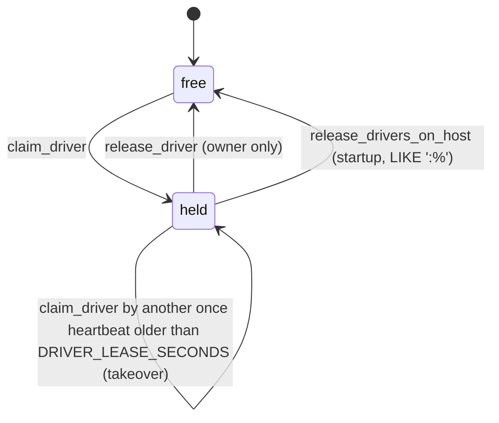
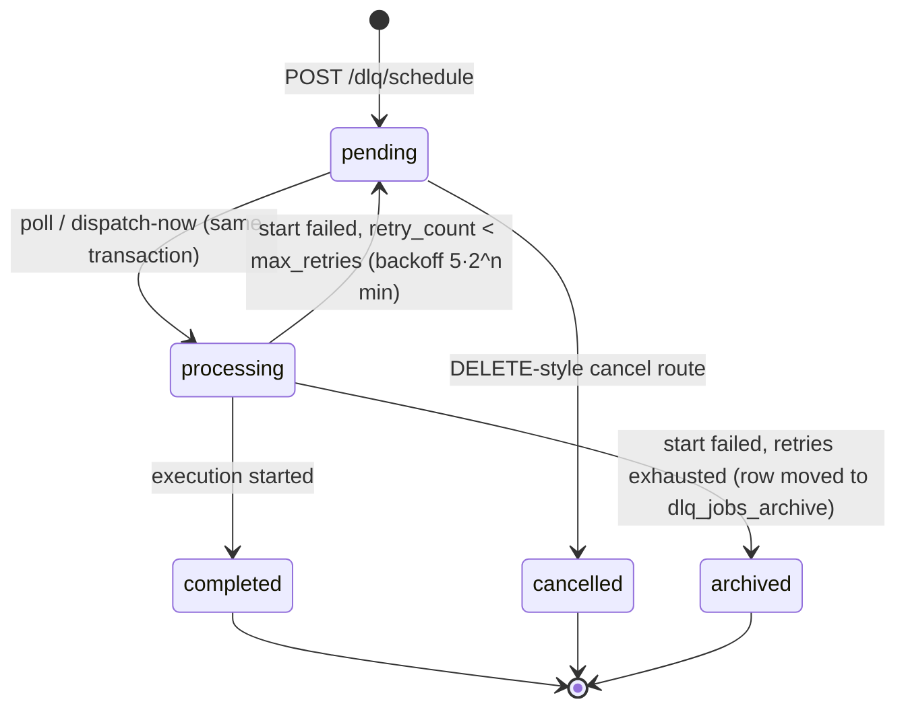

# Implicit state machines in Reflowfy

A map of every place in `reflowfy/` where an object moves through states that the code
never declares as a state machine: a string column, a nullable timestamp, a pair of
flags, a cursor. For each one: where the state lives, the transitions and who makes
them, the guard that makes each transition safe (or the lack of one), and the gaps.

Surveyed 2026-11-11 against `claude/reflowfy-implicit-state-machines-rst3ad`.

**Status.** F1 and F2 are fixed, and F3's state check: execution transitions are now
compare-and-set against `ExecutionState.FROM`, and a worker's writes to a job are fenced
by the token its claim writes to `jobs.claimed_by` (regression tests:
`tests/unit/test_state_transitions.py`). The tables below show the guards as they are
now; each finding says what was fixed and what is still open.

**How to read the guards.** A transition is *guarded* when the write itself checks the
from-state (`UPDATE … WHERE state IN (…)`, a compare-and-set). It is *checked* when the
code reads the state first and writes afterwards in a separate statement: that leaves a
race window. The job worker claim is guarded; almost every execution transition is only
checked.

## Inventory

| # | Machine | State lives in | Named states? | Transition guard |
|---|---------|----------------|---------------|------------------|
| 1 | Execution | `executions.state` | `store/states.py` `ExecutionState` | CAS against `ExecutionState.FROM` (was read-then-write, F1) |
| 1a | ↳ planning | `executions.plan_complete` | bool | write-once |
| 1b | ↳ driver lease | `executions.driver_id` + `driver_heartbeat_at` | owner kind in a string prefix | CAS on owner/staleness |
| 1c | ↳ hooks | `executions.hooks_fired_at`, `hook_error` | nullable timestamp | CAS (`IS NULL`) |
| 1d | ↳ rate bucket | `rate_limit_state` row existence | none | `SELECT … FOR UPDATE` |
| 2 | Job | `jobs.state` (+ `claimed_by`, `attempts`, `next_attempt_at`, `dispatched_at`, `updated_at`, `stats.retry_count`) | `JobState` | claim is CAS; the worker's later writes are fenced by `claimed_by` (were not, F2) |
| 3 | Worker delivery outcome | `JobStats` flags | `JobOutcome` (derived) | priority-ordered flags |
| 4 | Content-dedup claim | `processed_records` row | none | `INSERT … ON CONFLICT` |
| 5 | DLQ job | `dlq_jobs.status` + move to `dlq_jobs_archive` | bare strings | `FOR UPDATE SKIP LOCKED` (poll); none (cancel) |
| 6 | Cron schedule | `pipeline_schedules.enabled` (`"true"`/`"false"`), `next_run_at` | bare strings | `FOR UPDATE SKIP LOCKED` |
| 7 | Drive loop | locals in `PipelineRunner._drive_async` | none | n/a (one process) |
| 8 | Kafka consumer | `KafkaJobConsumer._running`, `_stop_requested` | two bools | single event loop |
| 9 | Kafka producer (dispatcher) | `KafkaJobDispatcher._producer`, `_started`, `_producer_loop` | none | single event loop |
| 10 | Pooled connection | `pool._Entry.holders`, `.retired`, membership of `_entries` | none | single event loop + per-key lock |
| 10a | ↳ health cache | `ConnectionPool._health[key]` timestamp | none | per-key lock |
| 10b | ↳ loop pool scope | `pool._loop_pools` (weak, by loop) | none | per loop |
| 11 | Transformation cursor | `applied_count` in `apply_transformations_iteratively_async` | none | invariant unchecked |
| 12 | SQL template scanner | `_BindPlacer.state` | string (`code`/`quote`/`dquote`/`line_comment`/`block_comment`) | explicit lexer |
| 13 | Background threads | `PeriodicTask._running`, `ElasticLogHandler._stop`, `_PlanLease._stopped` | bools/events | thread-local |
| 14 | API-side execution status | `ExecutionStatus.state` (`distributed_executor.py`) | `ExecutionState` | client-side only |

Machines 1 and 2 are the core: they are the source of truth that every service
coordinates through. 1a–1d and 3–4 are sub-machines tied to them. The rest are local
to one process.

---

## 1. Execution

`reflowfy/store/states.py` names the states. The transitions are spread over eight files.

| Transition | Writer | From-state check |
|---|---|---|
| → `pending` | `ExecutionManager.create_execution` (`execution.py:40`) | insert |
| `pending → running` | `PipelineRunner._plan_and_dispatch` | CAS from `pending` only (`from_states=`); lost to a cancel → `plan_aborted`, to a pause → plans, stays `paused` |
| `pending\|running → paused` | `ExecutionManager.pause_execution` | CAS |
| `paused → running` | `ExecutionManager.resume_execution` | CAS |
| non-terminal → `cancelled` | `ExecutionManager.cancel_execution`, from `/cancel` and `PATCH …/state` | CAS (409 when it loses) |
| non-terminal → `failed` | `PATCH …/state` | CAS (409 when it loses) |
| `running → completed\|failed` | `PipelineRunner._finalize_execution_state` | CAS, and only while no job is unfinished (else the loop goes on) |
| `* → failed` | `start.drive_execution` (`start.py:84`), `_recover_plan` (`pipeline_runner.py:1027`), `resume_execution` when the pipeline is missing (`pipeline_runner.py:379`) | none / `_recover_plan` checks first |
| terminal → `running` | `ExecutionManager.reopen_execution` from `/retry-failed` | CAS from terminal; the route starts a loop only when it won |

Every terminal transition goes through `update_execution_state`, which calls the
terminal listeners (lifecycle hooks, 1c). That single funnel is good. What it lacks is a
transition table: `update_execution_state(id, state)` writes whatever it is given, from
whatever the row holds.

**Who acts on the state.** The drive loop polls it about once a second and stops on
anything but `running` (`_drive_step`, `_send_jobs.should_stop`). The planner polls it
and aborts on `cancelled`/`failed`. The worker's retry write is gated on
`ExecutionState.ACTIVE`. Startup recovery resumes `running`, and `pending` with
`plan_complete = false` (`get_interrupted_executions`); `paused` is left alone on purpose.

### 1a. Planning (`plan_complete`)

`false` from `create_execution` → `true` from `mark_plan_complete` after the last job is
saved. It is never reset, `reopen_execution` included. Recovery reads it as "a fragment
of a plan exists": `_recover_plan` waits while the planning lease (1b) is fresh, then
fails the execution. This is effectively a third axis of the execution state:
`(state=running, plan_complete=false)` means "planning", `(running, true)` means
"dispatching".

### 1b. Driver lease (`driver_id`, `driver_heartbeat_at`)

One pair of columns is shared by three kinds of owner, told apart only by the
`driver_id` prefix:

| Owner | `driver_id` | Taken by | Heartbeat |
|---|---|---|---|
| planner | `plan:<host>:<pid>:<rand>` | `_PlanLease.start` | thread, every 10 s |
| recovery | `recover:<host>:<pid>:<rand>` | `_recover_plan` | none: taken only to fail the execution, then released |
| dispatch loop | `<host>:<pid>:<rand>` | `_wait_for_driver_lease` | every drive step and every second inside `_send_jobs` |

The claim and the heartbeat are compare-and-set, so this machine is sound. Two quirks:
`release_drivers_on_host` matches `'<host>:%'`, so at startup it frees dead *dispatch*
leases but not dead `plan:`/`recover:` ones (those wait out `DRIVER_LEASE_SECONDS`).
And `_PlanLease` ignores both a failed claim and a failed heartbeat: a planner whose
lease was taken keeps planning until its once-a-second state check sees `failed`.

### 1c. Lifecycle hooks (`hooks_fired_at`, `hook_error`)

`NULL → set` by `claim_hooks` (CAS on `IS NULL`), from the terminal listener's thread.
`set → NULL` by `reopen_execution`. `hook_error` is written after the hook or callback
fails.

### 1d. Rate-limit bucket (`rate_limit_state` row)

absent → present on the first `acquire_token` of a rate-limited execution
(`_get_or_create_state`) → tokens updated under `SELECT … FOR UPDATE` → `refill_rate`
rewritten when a resume brings a different rate → deleted by the drive loop's `finally`
when the execution is terminal (`_drop_rate_bucket`) and by the terminal listener. A
paused execution keeps its row. A reopened execution re-creates it.

---

## 2. Job

```mermaid
stateDiagram-v2
    [*] --> pending: create_jobs (planning)
    pending --> dispatched: mark_job_dispatched (after send; CAS on pending and on next_attempt_at)
    pending --> running: worker _claim_job (CAS, attempts+1)
    dispatched --> running: worker _claim_job (CAS, attempts+1)
    running --> completed: worker _write_job_row
    running --> failed: worker _write_job_row
    running --> deduplicated: worker _write_job_row
    running --> pending: job_retry scheduled (next_attempt_at, attempts=0; gated on execution ACTIVE)
    running --> pending: lease sweep, no heartbeat for JOB_RUNNING_LEASE_SECONDS
    running --> failed: lease sweep, attempts >= JOB_MAX_ATTEMPTS
    dispatched --> pending: lease sweep, unclaimed for JOB_DISPATCH_LEASE_SECONDS
    dispatched --> pending: local-mode resume (orphans)
    running --> pending: local-mode resume (orphans)
    pending --> cancelled: cancel_unstarted_jobs
    dispatched --> cancelled: cancel_unstarted_jobs
    pending --> failed: on_unsendable (message too large)
    failed --> pending: /retry-failed (requeue_failed)
```

| Transition | Writer | Guard |
|---|---|---|
| → `pending` | `JobManager.create_jobs` | insert |
| `pending → dispatched` | `JobManager.mark_job_dispatched` (`job_manager.py:101`) | CAS: `state = pending` and `next_attempt_at` before the send began |
| `pending\|dispatched → running` | `WorkerExecutor._claim_job` (`executor.py:777`) | CAS: `state IN UNSTARTED` and backoff passed; **fails open** on a DB error |
| `running → completed\|failed\|deduplicated` | `WorkerExecutor._write_job_row` | `state = running AND claimed_by = <token>`; a loss is `superseded` |
| `running → pending` (retry) | `_write_job_row` with `retry_in` | execution `ACTIVE`; not the job's own state |
| `running → pending\|failed`, `dispatched → pending` | `JobManager.reclaim_expired_leases` (`job_manager.py:179`) | CAS on state and timestamp |
| `dispatched\|running → pending` | `PipelineRunner.resume_execution`, local mode (`pipeline_runner.py:417`) | none (the process that ran them is gone) |
| `pending\|dispatched → cancelled` | `JobManager.cancel_unstarted_jobs` | CAS |
| `pending → failed` | `on_unsendable` → `JobManager.update_job_state` (`job_manager.py:246`) | **none** (generic setter) |
| `failed → pending` | `JobManager.requeue_failed` | CAS |
| heartbeat (`updated_at`) | `WorkerExecutor._heartbeat_job` | `state = running AND claimed_by = <token>` |

The lease sweep runs only inside a live drive loop, so the jobs of a paused execution are
not swept until it is resumed.

Sub-state carried beside `state`: `attempts` (claims, the lease budget; reset by a
retry or a requeue), `next_attempt_at` (a pending job that is not yet due), `stats.retry_count`
and `stats.error_history` (the `job_retry` budget, read back by `_previous_retries`).

## 3. Worker delivery outcome (`JobStats`)

`executor.py:94`. Each delivery of a message ends in one outcome, derived from flags in
priority order:

`cancelled` → `retry_scheduled` → `redelivered` → `deduplicated` → `skip_reason` (SkipJob)
→ `success` (completed / failed).

`outcome` (the metrics label) and `stored_state` (the job row) are two projections of
the same flags. `cancelled` and `redelivered` write no row; `skipped` stores
`completed`; `retry_scheduled` stores `pending`. The flags are independent booleans set
at different points of `_execute_job_inner`, so the priority order is what makes the
combination well-defined.

## 4. Content-dedup claim (`processed_records`)

absent → claimed by job J (`claim_record_hashes`, `INSERT … ON CONFLICT DO NOTHING`;
a row already held by the same `job_id` counts as won) → released on any failure or
shutdown (`release_record_hashes`, `WHERE job_id = J`) or kept after a successful send →
purged after `CONTENT_DEDUP_RETENTION_HOURS`. Ownership is the `job_id`, not the delivery.

## 5. DLQ job (`dlq_jobs.status`)

States are bare strings in `dlq_scheduler.py`, `dlq_routes.py` and `stats_routes.py`;
`archived` is not a status at all but a move to another table. `processing` is only ever
flushed, never committed: the poll sets it and the final status in one transaction, so
no other session can see it.

## 6. Cron schedule (`pipeline_schedules`)

`enabled` is the string `"true"`/`"false"`. `sync_schedules_from_registry` (startup)
inserts a declared schedule, re-enables one that is declared again, and disables one no
longer declared; nothing else toggles it. `next_run_at` advances on every fire, whether
the trigger succeeded or not, and on a manual run (`reset_schedule`).

## 7. Drive loop

`PipelineRunner._drive_async` and `_drive_step`, in-process:

- **standby**: `_wait_for_driver_lease` retries every 15 s while another loop holds the
  lease; leaves if the execution stops being `running`.
- **driving**: each step heartbeats, re-reads the execution state, sweeps leases once a
  minute, ends the execution when no job is pending or in flight, and otherwise tops up
  the in-flight window.
- **stalled**: a sub-state in `track` (`progress_at`/`warned_at`); warns every 10 min.
- **db-backoff**: a `DBAPIError` sleeps 5 s doubling to 60 s and retries the step.
- **stopped**: lease lost (`driver_replaced`), state not `running` (`dispatch_stopped`),
  or the execution finalized. The `finally` closes the dispatcher and drops a terminal
  execution's rate bucket.

## 8. Kafka consumer

`worker/consumer.py`. `connecting` (10 tries, exponential backoff; `_stop_requested`
exits) → `running` (`_running = True`, loop pool open) → `draining` (`request_stop` sets
`_running = False`; the message in hand finishes and commits) → `stopped` (consumer
stopped, executor closed, loop pool closed). A second signal exits at once
(`worker/main.py`).

## 9. Kafka producer (manager dispatcher)

`KafkaJobDispatcher._get_producer`: none → started (bound to the running loop) → reset
when the loop changed or closed (discarded, not stopped) → stopped by `close()`.

## 10. Pooled connection

`destinations/pool.py`. A `_Entry` is:

- **idle**: in `_entries`, no holders. Closed by idle eviction (`_take_idle`) after
  `DESTINATION_POOL_IDLE_SECONDS`.
- **held**: in `_entries`, one or more holders (`get(..., holder=)`; `release`).
- **retired**: evicted after an error while held; out of `_entries`, in `_retired`;
  closed on its last `release`.
- **closed**: by eviction with no holders, by `release` of a retired entry, or by
  `close()` of the pool.

A job's pool delegates to the loop's pool when one is open (`_delegate`), so the holder
there is the job's pool. Health (10a): a healthy probe is cached for 30 s; an unhealthy
one clears the entry. Loop pool (10b): opened by the worker, `LocalDispatcher` and
`reflowfy test`; closed at the end of that scope.

## 11. Transformation cursor

`execution/transformation_runner.py:207`. `applied_count` is a cursor into a list
that `define_transformations` re-resolves after every step. States per position:
unapplied → applied (`sync`/`async`/`per_record`) or declined (`skipped`). The loop ends
when the re-resolved list is no longer than the cursor; `max_steps` caps runaway growth.
The documented invariant (the list is append-only) is not checked: if re-resolution
changes an already-applied position, nobody notices.

## 12. SQL template scanner

`sources/sql.py:113` `_BindPlacer` is the one explicit state machine in the package: a
lexer with five string states and a handler per state. It is self-contained and has no
concurrency.

## 13. Background threads

`PeriodicTask` (DLQ scheduler, cron scheduler, dedup sweeper): `_running` + `_stop_event`,
start is idempotent, stop waits up to 10 s. `ElasticLogHandler`: shipper thread +
`_stop` event + `atexit` drain. `_PlanLease`: started → beating → stopped (`_stopped`
makes `stop` idempotent). `lifecycle._running`: the set of hook threads still running,
which shutdown waits on.

## 14. API-side execution status

`execution/distributed_executor.py`: the API builds an `ExecutionStatus` in `running`
before it posts `/run`, keeps `running` on a 2xx (the manager row is `pending` at that
point), and turns it into `failed` on any HTTP error.

---

## Findings

Ranked by impact. F1 and F2 were reproduced with throwaway tests against SQLite
(not committed). The rest are from reading the code.

### F1. Execution transitions are read-then-write, so concurrent ones overwrite each other — reproduced, fixed

**Fixed:** `update_execution_state` is a compare-and-set against `ExecutionState.FROM`;
the planner moves `pending → running` only; finalize also requires no unfinished job;
`reopen_execution` is CAS from terminal and `/retry-failed` starts a loop only when it
reopened; `PATCH …/state` answers 409 when the CAS loses. What follows is the bug as found.

There is no compare-and-set on `executions.state`. The guarded-looking methods read the
row, then write unconditionally; two writers (`_plan_and_dispatch`,
`_finalize_execution_state`, `reopen_execution`) do not even read.

- **Cancel or pause before planning starts is lost (reproduced).** `/run` answers 202 with
  the execution `pending`. A `/cancel` (or `/pause`) that lands before the background
  planner reaches `update_execution_state(RUNNING)` (`pipeline_runner.py:538`) is
  overwritten: the cancelled execution goes back to `running`, plans and dispatches
  everything. `on_execution_cancelled` and the callback have already fired, and
  `hooks_fired_at` is set, so `on_execution_complete` never fires for the run that
  actually happened. The planning window is at least `pipeline.resolve()` (defaults,
  validation, `define_source`, `define_jobs`), and longer for a DLQ or cron start, whose
  thread starts after the poll. `test_planning_stops_when_the_execution_is_cancelled`
  covers a cancel *after* that write, not before.
- **Finalize can overwrite a cancel or a force-fail.** `_drive_step` reads `running`, then
  counts the jobs and calls `_finalize_execution_state`, which writes
  `completed`/`failed` regardless. A `/cancel` in between ends `failed` (its cancelled jobs
  count as unfinished) or `completed`.
- **Pause can un-finish an execution.** `pause_execution` reads `running`; if the loop
  finalizes before the write, `completed → paused`. The hooks have fired; a later `/resume`
  finalizes again and the hooks do not fire again.
- **`/retry-failed` racing the loop's end leaves an execution `running` with no loop.**
  The route reads `was_running = True`, the loop finalizes, `reopen_execution` writes
  `running`, and no background resume is scheduled because the execution "was running".
  It stays `running` until a manager restart picks it up in `get_interrupted_executions`.
  `reopen_execution` also accepts a `pending` execution that is still planning.

Suggested fix: a transition table next to `ExecutionState` (`ALLOWED = {RUNNING:
(PENDING, PAUSED), …}`) and one `transition(id, to, from_states)` that does
`UPDATE executions SET state = :to WHERE execution_id = :id AND state IN :from` and
returns whether it won. Notify the terminal listeners only when it won.
`_plan_and_dispatch` would then move `pending → running` and abort when the CAS loses.

### F2. The worker's final job write is not fenced — reproduced, fixed

**Fixed:** the claim writes a token to `jobs.claimed_by`; the heartbeat, the outcome and
the retry write require it, and the worker checks ownership right before the send. A
delivery that lost the job sends nothing more, writes nothing, logs `job_claim_lost` and
counts as `jobs_processed_total{status="superseded"}`. Still open: a worker that loses
the job *during* the send has written its records (dedup claims stay keyed by `job_id`).
What follows is the bug as found.

`_write_job_row` updates `WHERE job_id = …` with no check of the job's state or of
which delivery owns it, and the heartbeat refreshes any `running` row. A job has no owner
token; `attempts` is a counter, not a fence. So a delivery that lost its claim still
writes:

- a worker that stalls past `JOB_RUNNING_LEASE_SECONDS` (GC pause, network partition,
  DB outage) sees its job requeued and claimed by a second worker; the first one's
  heartbeat keeps the second one's lease alive, and both write the outcome, last one wins;
- a job cancelled after the lease sweep requeued it is turned back to
  `completed`/`failed` by the late worker (reproduced: `cancelled → completed`);
- a job the sweep failed for running out of attempts is flipped to `completed`;
- content dedup (4) treats a claim held by the same `job_id` as won, so the stale worker
  and its successor both pass dedup and both send.

`_claim_job` also fails open on a DB error, which is by design (at-least-once) but means
the job runs without any row transition at all.

Suggested fix: make the claim return a fencing token (the new `attempts` value, or a
`claimed_by` column), and add `AND state = 'running' AND attempts = :token` to the
heartbeat, the final write and the retry write. A write that matches no row means
another delivery owns the job: log it and count it as `redelivered`.

### F3. Lifecycle hooks are at-most-once, not exactly-once — partly fixed

**Fixed:** `claim_hooks` requires a terminal state in the same statement. **Still open:**
no sweep re-fires hooks lost to a crash; CLAUDE.md now says "at most once".

`claim_hooks` sets `hooks_fired_at` before the hook runs, and the hook runs on a thread
started after the terminal commit. A manager that dies between the commit and the
thread, or while the hook runs, leaves `hooks_fired_at` set (or `NULL` with a terminal
state), and nothing sweeps for it: startup recovery only looks at `running`/`pending`
executions. CLAUDE.md describes the hooks as "exactly once"; the claim guarantees "never
twice". Separately, `fire_execution_hooks` checks the state is terminal and then claims
in a second statement without re-checking it, so a `reopen_execution` in between lets a
running execution's hooks be claimed, and its real end then fires nothing.

Suggested fix: claim with `AND state IN TERMINAL`, and if exactly-once matters, a
startup sweep for terminal executions with `hooks_fired_at IS NULL` (for the
crash-before-claim window).

### F4. DLQ and cron start an execution before their own transaction commits

`DLQScheduler._dispatch_jobs` and `PipelineScheduler._trigger_pipeline` create the
execution in a separate session, commit it and start its thread, then mark the DLQ job
`completed` / advance `next_run_at` in the poll's transaction, committed at the end of
the poll. If that commit fails or the manager dies first, the rows are still due and the
next poll starts a second execution. Starting runs at-least-once may be acceptable, but
it is not stated anywhere.

Also in the DLQ machine: `processing` is never visible (see 5), so it is a phantom
state; and the cancel route reads without a lock, so a cancel racing the poll waits
for the poll's commit and then overwrites `completed` with `cancelled` for a job whose
execution already started.

### F5. States as bare strings outside `store/states.py`

`ExecutionState`/`JobState` exist, but these still compare or write literals:
`app.py` (`"failed"`/`"cancelled"` in the PATCH route's 422 check, `"pending"` in the `/run` answer),
`job_manager.get_job_counts` (a hand-written dict of every job state), all DLQ statuses,
(the ones in `pipeline_runner.py` and the routes' writes now use the constants)
and the schedule `enabled` strings. A `DLQStatus` class beside the other two, and the
counts dict built from `JobState.ALL`, would make a new state a one-place change.

### F6. Smaller ones

- `JobManager.update_job_state` is a generic, unguarded setter; its only caller is
  `on_unsendable` (`pending → failed`). It sets `completed_at` for `completed`/`failed`
  but not `deduplicated`.
- `release_drivers_on_host` frees only dispatch leases (1b); a planner or recovery lease
  left by the previous process on the same host still waits out `DRIVER_LEASE_SECONDS`.
- The transformation cursor's append-only rule (11) is documented, not enforced.
- API-side status (14): a `/run` that times out after the manager committed the
  execution is reported `failed` (502) while the run goes ahead.
- `consumer.py` has a duplicated `break` after `consumer.start()`, and its comment says
  "the DLQ (POST /dlq/schedule) owns re-runs", which CLAUDE.md says the DLQ does not.
